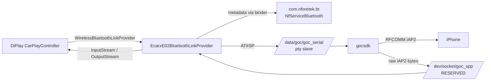

# DiPlay wireless CarPlay on ECarX E02

Implementation notes for the experimental ECarX E02 path (verified on `ecarx SS11R`,
board `IHU524P`, Android 9 / API 28, Mediatek MT6771, firmware build
`PQ2A.190405.003`).

This describes how DiPlay boots iAP2 wireless CarPlay over the vendor Bluetooth
stack when Android's Bluetooth adapter never turns on.

---

## 1. Why the normal Android Bluetooth path cannot work

Two Bluetooth stacks exist on the unit:

| Stack | State |
|---|---|
| Android AOSP (`com.android.bluetooth`, `IBluetoothManager`) | installed, adapter `STATE_OFF`, never enabled |
| Vendor stack (`/system/bin/gocsdk` + `com.nforetek.bt`) | owns `/dev/stpbt`, carries calls and music |

Observed facts:

- `/dev/stpbt` is held by `gocsdk` from boot; it is single-open.
- `svc bluetooth enable` loops: `BLE_TURNING_ON` → `BLE_START_TIMEOUT` → off.
- The vendor daemon performs the chip power-on/firmware load itself.
- `/dev/socket/goc_serial`, `/dev/goc_serial` do **not** exist.
- `/data/goc/goc_serial` exists as a **symlink to a pty** (for example
  `/dev/pts/0`). Mode `666`, owner `root`. `gocsdk` holds the pty master, the
  vendor app (`com.nforetek.bt`) holds the slave.

Consequences:

- `BluetoothAdapter` APIs are useless for CarPlay here.
- `LocalSocket.connect()` on `/data/goc/goc_serial` fails with `ECONNREFUSED`
  because the target is a pty, not a Unix socket.
- Reading the pty from DiPlay would steal command replies from the vendor app.
  Write-only is mandatory.

---

## 2. Architecture

DiPlay keeps its normal path for every other head unit and adds a provider seam.
On E02 the provider supplies the RFCOMM byte link; everything after the link
(iAP2 identification, MFi authentication, StartSession, AirPlay) is unchanged.



Data flow:

1. DiPlay resolves the phone (vendor binder: current auto-connect address plus
   the saved address).
2. `goc_spp` is opened and identified with a 12-byte address handshake.
3. `AT#SP<address><iAP2 UUID>` is written to the vendor pty.
4. `gocsdk` runs SDP, opens RFCOMM to the iPhone, and pipes the iAP2 bytes
   through `/dev/socket/goc_spp`.
5. DiPlay wraps those streams in `BluetoothRfcommDuplexStream` and starts iAP2.
6. iAP2 is accessory-initiated: DiPlay writes the first identification frame.
   Waiting for an inbound byte before writing tears down a healthy channel.

---

## 3. Vendor interfaces

### 3.1 Metadata (binder)

Service: `com.nforetek.bt.service.NfServiceBluetooth`
AIDL package: `com.nforetek.bt.aidl`

DiPlay copies only the needed AIDL declarations into
`shared/src/main/aidl/com/nforetek/bt/aidl/`:

- `INfCommandBluetooth.aidl`
- `INfCallbackBluetooth.aidl`

Used methods:

| Method | Purpose |
|---|---|
| `isBluetoothServiceReady()` | readiness before calls |
| `getBtLocalAddress()` | head-unit Bluetooth MAC for AirPlay identity |
| `getBtAutoConnectingAddress()` | current/recent vendor phone |
| `getBtRemoteDeviceName(address)` | display name |

Binding details:

- `bindService` with `BIND_AUTO_CREATE`; 5 s bind timeout; 3 s service-ready poll.
- One process-wide binding; daemon teardown on `onDestroy` makes unbinding
  undesirable.
- `INfCommandBluetooth` encodes device addresses as `AA:BB:CC:DD:EE:FF`;
  the wire protocol uses compact uppercase `AABBCCDDEEFF`.

The vendor SPP service (`NfServiceSpp`) exists and exposes
`INfCommandSpp.reqSppConnect(address)`, but it sends `AT#SP<address>` with an
**empty UUID** (`str_to_uuid invalid`) and its `isSppConnected()` does not see
channels opened through the pty. It is not used.

### 3.2 Control channel: `/data/goc/goc_serial`

- It is a symlink to a pty slave (`/dev/pts/N`), not a socket.
- Open it as a plain file for write only:
  `FileOutputStream(File("/data/goc/goc_serial"))`.
- Do not open a reader. The vendor app consumes the replies.
- Commands are ASCII lines terminated with `\r\n`.

### 3.3 Data channel: `/dev/socket/goc_spp`

- Unix stream socket in the Android reserved namespace:
  `LocalSocketAddress("goc_spp", Namespace.RESERVED)`.
- It is a **listening** socket created by the vendor stack.
- Android 9's `LocalSocket.connect(address, timeout)` overload is a stub that
  throws `UnsupportedOperationException`; use the no-timeout overload.
- A client identifies its device by writing the 12-byte compact address before
  the daemon starts carrying bytes for that device.

---

## 4. Wire protocol

### 4.1 Connect

```text
AT#SP<12 hex address><36 char dashed UUID>\r\n
```

Example:

```text
AT#SP5CADBAB97E0600000000-deca-fade-deca-deafdecacafe\r\n
```

Rules:

- Address: compact uppercase hex, 12 characters.
- UUID: **dashed** canonical form. The dashless 32-hex form is rejected by
  `str_to_uuid` and logs `ON_CONNECT_SPP,uuid conver fail`.
- Device: iAP2 UUID `00000000-deca-fade-deca-deafdecacafe`.
- Trailing CRLF required.

### 4.2 Data handshake

```text
<12 ASCII hex address>
```

Write this to `goc_spp` before the `AT#SP` line. It associates the client with
the device. No ack is read by DiPlay.

### 4.3 Disconnect

```text
AT#SH<12 hex address>\r\n
```

Sent when the link closes or an attempt fails.

### 4.4 Vendor result codes (observed)

`gocsdk` logs `SPP_CONNECT_IND result N`:

| Result | Meaning observed |
|---|---|
| `0` | connected; RFCOMM channel open |
| `8` | connect failed/aborted; frequently transient while the phone link settles |
| `22` | SDP/RFCOMM search failed (phone not connected, service not found) |
| `49` | attempt aborted/superseded |

`result 8` can alternate with `result 0` between attempts. DiPlay relies on the
normal connection retry loop; it does not poll a vendor state API.

---

## 5. DiPlay code map

| File | Role |
|---|---|
| `shared/.../transport/WirelessBluetoothLinkProvider.kt` | provider seam: `Phone`, `Link` streams, `pairedPhones`, `selectPhone`, `localAddress`, `open` |
| `shared/.../transport/EcarxE02BluetoothLinkProvider.kt` | gating, phone list/resolution, metadata binder, bridge handoff |
| `shared/.../transport/EcarxE02BluetoothBridge.kt` | pty control, `goc_spp` data, handshake, protocol writes, link close |
| `shared/.../transport/EcarxE02BluetoothProtocol.java` | address validation/canonicalisation, command atoms, iAP2 UUID |
| `shared/.../orchestration/CarPlayController.kt` | selects the provider, skips the Android radio check, wraps the stream, uses the vendor local MAC for identification |
| `common/.../DiPlayActivity.kt` | E02 phone chooser (`chooseEcarxPhone`) and provider gating |
| `mobile/src/main/AndroidManifest.xml` | `<queries><package android:name="com.nforetek.bt"/></queries>` |
| `shared/src/main/aidl/com/nforetek/bt/aidl/` | vendor binder AIDL copies |

### 5.1 Gating

```kotlin
Build.MANUFACTURER == "ecarx" (ignore case)
Build.PRODUCT      == "IHU524P" (ignore case)
PackageManager.getServiceInfo(
    ComponentName("com.nforetek.bt", "com.nforetek.bt.service.NfServiceBluetooth"), 0
).exported == true
```

Only then is a provider created. Every other head unit keeps the Android path
byte-for-byte.

`CarPlayController` also exposes an internal constructor taking a
`WirelessBluetoothLinkProvider`; the default field uses
`createIfSupported(appContext)`. `DiPlayActivity.choosePhone()` uses the same
factory so the phone list comes from the vendor stack.

### 5.2 Controller integration points

1. **Provider selection** before the hotspot starts. `selectPhone` and
   `localAddress` run on the wireless executor.
2. **Radio check** (`BluetoothRadioCheck.blockerForState`) is skipped when a
   provider is present. Android Bluetooth is off by design on E02.
3. **RFCOMM stream** comes from `provider.open(phone)` and is wrapped in
   `BluetoothRfcommDuplexStream`; `InstantBluetoothLink` and adapter-proof
   recording are Android-path only.
4. **Identity** uses `provider.localAddress()` for `btMac` and
   `Iap2WirelessIdentification`, and the hotspot BSSID for `deviceIdentifier`.
5. **No first-byte wait**. The link is returned immediately after the command.

### 5.3 Phone selection

`pairedPhones(preferredAddress)` returns at most:

- the vendor's current auto-connect address, and
- the saved DiPlay phone address (if different).

`selectPhone` returns the saved address when set, otherwise the only candidate.
There is no vendor API to enumerate every bonded phone.

---

## 6. Build and install

CarPlay authentication requires the private local MFi identity. Source builds
are identity-free by design.

```sh
DIPLAY_AUTH_ASSETS_DIR=/absolute/path/runtime-assets \
  ./gradlew :mobile:assembleStandaloneDebug
```

`runtime-assets/offline-mfi/` must contain:

```text
identity.pk8
certificate.p7b
```

Verify the APK:

```sh
unzip -l mobile/build/outputs/apk/debug/mobile-debug.apk | grep offline-mfi
```

Debug application id: `com.shihab.diplay.hudtest`.

Install over the previous build with the same signing key:

```sh
pm install -r -d /data/local/tmp/mobile-debug.apk
```

Do not uninstall; settings and the provisioned identity live in app data.

---

## 7. Device setup

### 7.1 Car hotspot

Use the car's own hotspot (`WirelessHotspotMode.MANUAL`) and enter its details
in DiPlay exactly:

- SSID is **case-sensitive**. On the reference unit the real SSID was
  `ProtonWiFi_131861` while DiPlay had saved `ProtonWifi_131861`; the iPhone
  never joined. Read the real value from
  `/data/vendor/wifi/hostapd/hostapd_ap0.conf` (`ssid2` is hex) or the car UI.
- Passphrase must match `wpa_passphrase`.
- Channel on the reference unit is 11 (2.4 GHz, 20 MHz); store the same channel.
- Keep `hotspot_address_family` at `IPv4`. The app flips it to `IPv6` after a
  first-TCP timeout; on E02 only link-local IPv6 exists and that attempt fails.
- The hotspot must stay on while DiPlay connects.

### 7.2 iPhone

- The iPhone must be **connected**, not merely paired, on the car's Bluetooth
  (calls/music). SPP connect fails with `result 8`/`22` when the ACL link is down.
- The iPhone joins the car hotspot automatically from the iAP2 Wi-Fi
  configuration. No manual join is required when SSID/passphrase are correct.
- Accept the CarPlay prompt if it appears.

### 7.3 Do not use Wi-Fi P2P

`Wi-Fi P2P (5 GHz)` crashes `system_server` on this firmware:

```text
FATAL EXCEPTION IN SYSTEM PROCESS: WifiP2pService
NullPointerException: Attempt to write to field
WifiP2pDevice.interfaceAddress on a null object reference
at WifiP2pServiceImpl$P2pStateMachine$GroupCreatedState.processMessage
```

`system_server`, `com.android.car`, `ecarx.power.service` and DiPlay all restart.
Keep `wireless_hotspot_mode=MANUAL` until the framework NPE is addressed.

---

## 8. Verification

### 8.1 App log

Expected order:

```text
ECarX /data/goc/goc_serial opened as a device
ECarX goc_spp connected
ECarX address handshake written to goc_spp
ECarX gocsdk RFCOMM bridge ready
wireless iAP2 CSM channel opened over RFCOMM
iap2 identification accepted
iap2 authentication accepted
wireless startup ... authenticated=true tcpAccepted=1 sessionActive=true
```

Failure shapes:

| Log | Meaning |
|---|---|
| `/data/goc/goc_serial open failed: ... EACCES` | app uid cannot open the pty |
| `goc_spp connected` then nothing | command not delivered, or SPP failed (`result 8`) |
| `ECarX gocsdk bridge failed` | control or data socket missing |
| `authenticated=true tcpAccepted=0` | iPhone did not reach AirPlay TCP; check Wi-Fi join/SSID/IP |

### 8.2 Vendor log (read-only)

With a root UART shell:

```sh
logcat -d -v brief | grep -aE 'command:AT#S|SPP_CONNECT_IND|on_spp_connect|spp Connected' | tail -40
ip neigh show dev ap0
hostapd_cli -i ap0 -p /data/vendor/wifi/hostapd/ctrl status
```

Healthy sequence:

```text
command:AT#SP<addr><dashed uuid>
ON_CONNECT_SPP
SPP_CONNECT_IND result 0
on_spp_connect spp_num=N id=..,channel=..
```

### 8.3 Read-only device probes

```sh
ls -l /data/goc/goc_serial
stat -c '%F %a %U:%G' /data/goc/goc_serial
cat /proc/net/unix | tr -d '\0' | grep -E 'goc|rfcomm'
cat /data/vendor/wifi/hostapd/hostapd_ap0.conf
```

---

## 9. Hard-won pitfalls

1. **Android 9 `LocalSocket.connect(address, timeout)` throws
   `UnsupportedOperationException`.** Use the no-timeout overload.
2. **`/dev/socket/goc_serial` does not exist on E02.** The control endpoint is
   `/data/goc/goc_serial`, a pty.
3. **Never read the pty.** It steals the vendor app's command responses.
4. **Do not drain or block on the pty before writing.** Open, write, flush.
5. **The UUID must be dashed.** `00000000decafade...` is rejected.
6. **Address must be compact uppercase** in the command and handshake.
7. **iAP2 is accessory-initiated.** Never wait for an inbound byte before the
   first identification write.
8. **`isSppConnected` from `NfServiceSpp` is blind** to channels opened through
   the pty; polling it produces false negatives and tears down good sessions.
9. **`NfServiceSpp.reqSppConnect` is unusable** for CarPlay: it sends an empty
   UUID.
10. **SSID case matters.** A one-character case difference prevents association.
11. **The address-family preference flips to IPv6** after 30 s without TCP; on
    E02 that is a dead end. Reset to IPv4 when retesting.
12. **Wi-Fi P2P crashes system_server.** Do not use it.
13. **Source builds have no MFi identity** unless `DIPLAY_AUTH_ASSETS_DIR` is set.

---

## 10. Performance

Observed on the reference unit:

- Hotspot: 2.4 GHz channel 11, 20 MHz, `hw_mode=g`.
- Decode is not the bottleneck: `decode p50=6 ms`, `late=0`, `recoveries=0`.
- The iPhone collapses video to roughly 0.05-0.4 Mbps with 1-2 s gaps, which
  shows as softness and low frame rate.
- `COMBO` chip coexistence with `tbox0` LTE traffic aggravates this.

Options:

1. Use a 5 GHz car hotspot if the car exposes the choice (not available on the
   reference unit).
2. Do not use Wi-Fi P2P until the framework NPE is patched.
3. Settings → **Advanced** → **Video and audio**:
   - `Efficient video (HEVC)` if a hardware HEVC decoder exists.
   - `Direct video output (experimental)`.
   - `MTK decoder low latency (experimental)`.
   - `Low-latency decoding (experimental)`.
   - `Smooth video (experimental)` adds delay; not for latency.
4. Lower the CarPlay resolution one step; fewer pixels at the same bitrate is
   sharper.

HEVC with a software decoder is worse; check the log line:
`HEVC is on, but no hardware decoder plays it`.

---

## 11. Future work

- Replace the fixed `result 8` retry latency with a connection-attempt budget
  that fails fast for the user.
- Stop `flipWirelessAddressFamily` from choosing link-local IPv6 when it is the
  only IPv6 candidate.
- If firmware P2P is ever patched, evaluate 5 GHz P2P for bandwidth.
- Consider surfacing the exact vendor failure (`result 8/22/49`) in the Error
  dialog instead of a generic Bluetooth error.
- A `services.jar` patch for `WifiP2pServiceImpl` would enable the 5 GHz path
  without touching DiPlay code, but it is a system modification and out of scope
  for app-only deployment.

---

## 12. Safety rules for this device

- Do not write to `/system`, `/vendor`, `/product`, or `hostapd` configuration
  files.
- App install, app data, and `/data/local/tmp` are the only write targets.
- Vendor inspection is read-only: `ls`, `stat`, `cat`, `logcat`, `hostapd_cli`,
  `/proc`.
